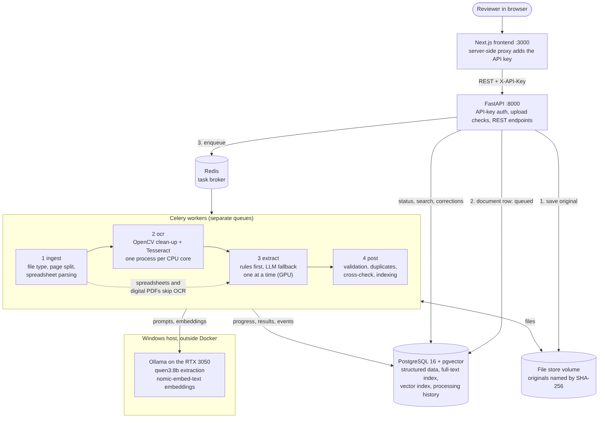

# Document Intelligence System

An AI-powered system that reads invoices from PDF, JPG, PNG, TIFF, XLSX, XLS
and CSV files, extracts structured data, validates it, cross-checks documents
against each other, and makes everything searchable through a REST API and a
web interface.

Built for the Care Guide AI Engineer assessment (Project: AI-Powered Document
Intelligence System) by Pretom Chandra Roy, with AI assistance as disclosed in
[`docs/AI_DISCLOSURE.md`](docs/AI_DISCLOSURE.md).

**Walkthrough video:** to be added.

## Results at a glance

Measured on a held-out test set of 155 labelled documents (185 invoices) on one
consumer desktop, with the language model running locally. Full details in
the [evaluation report](evaluation/REPORT.md).

| Metric | Result |
|---|---|
| Document success rate / unexpected failure rate | 100% / 0% |
| Corrupted, encrypted and empty files rejected with the right reason | 5 of 5 |
| Field accuracy (8 header fields), all formats | 93.6% |
| Field accuracy, digital PDFs / spreadsheets | 99.6% / 100% |
| Wrong invoices approved without review | 0 |
| Digital PDF, median time per page | 153 ms |
| 1,000-page PDF with 760 invoices | all 760 split correctly, 99.1% field accuracy |
| Automated tests | 143 passing, 92% line coverage |

## What it does, against the brief

| Brief | How it is met |
|---|---|
| **Task 1.** Accept PDF, JPG, PNG, TIFF, XLSX, XLS, CSV; digital text, OCR, spreadsheets; multi-page, multi-sheet, poor quality, corrupted | File type checked from content, not extension. Each PDF page is classified as digital or scanned, so mixed PDFs work. Scans are cleaned (denoise, deskew, upscale, background flattening) and read with Tesseract. Spreadsheets are parsed natively in three layouts (form, multi-sheet, ledger). Corrupted, encrypted and empty files fail cleanly with an error code |
| **Task 2.** Extract the nine fields as JSON without inventing values | Rules first; a local language model only when the rules are incomplete or the arithmetic does not agree. The model is constrained by a JSON schema, and every value it returns must be found in the source text or it is discarded. Unprinted fields stay `null` |
| **Task 3.** Missing fields, wrong numbers, duplicates, subtotal/tax/line/total consistency, manual review | Ten validation rules; any error or low-confidence key field sends the invoice to the review queue |
| **Scenario.** PDF-to-PDF and PDF-to-Excel cross-verification | Invoices that share a supplier and invoice number are grouped across documents and compared field by field and line by line |
| **Scenario.** PDFs of about 1,000 pages | Multi-invoice PDFs are split by invoice; OCR runs in parallel batches of 20 pages. Measured on a 1,000-page PDF: 760 of 760 invoices split correctly ([report, section 3.8](evaluation/REPORT.md#38-large-pdf-1000-pages)) |
| **Task 4.** REST API for upload, status, results, search, corrections, reprocessing; background jobs | FastAPI; Celery with Redis on four queues (ingest, OCR, extract, post) |
| **Task 5.** Metadata, text, results, errors, history; keyword and semantic search | PostgreSQL with full-text search, pgvector embeddings and a hybrid ranking of both |
| **Task 6.** React or Next.js interface | Next.js: upload with progress, review and correction side by side with the page image, cross-checks, search |
| **Task 7.** Automated tests; labelled evaluation with measured metrics | 143 tests; a 219-document labelled dataset; [evaluation report](evaluation/REPORT.md) |

## Architecture



| Component | Technology |
|---|---|
| Frontend | Next.js 15 (App Router, TypeScript), Tailwind CSS, TanStack Query |
| API | Python 3.13, FastAPI, Pydantic, SQLAlchemy 2, Alembic |
| Background jobs | Celery with Redis |
| Database and search | PostgreSQL 16 with pgvector and pg_trgm |
| OCR | OpenCV pre-processing, Tesseract 5 |
| Language model | `qwen3:8b` through Ollama, on the local GPU |
| Embeddings | `nomic-embed-text` through Ollama |
| Deployment | Docker Compose: database, Redis, API, CPU worker, model worker, frontend |

Documentation:

- [Architecture](docs/ARCHITECTURE.md): pipeline, extraction, validation, search, performance, reliability, security
- [Database schema](docs/DATABASE.md) and [diagram](docs/diagrams/schema.png)
- [REST API](docs/API.md); interactive documentation at `http://localhost:8000/docs` when running
- [Requirements tracker](docs/REQUIREMENTS.md): every requirement of the brief and where it is met
- [Evaluation report](evaluation/REPORT.md) and [dataset](evaluation/dataset/README.md)
- [AI disclosure](docs/AI_DISCLOSURE.md); the prompts the system sends to the model are in [`backend/app/prompts/`](backend/app/prompts/)

## Setup on Windows

Tested on Windows with an AMD Ryzen 5 5500, 16 GB RAM and an NVIDIA RTX 3050
(8 GB). The model needs about 6.2 GB of GPU memory. Without a suitable GPU the
system still runs with the mock model (step 4), but extraction then relies on
the rules alone.

**1. Install the prerequisites**

- [Docker Desktop](https://www.docker.com/products/docker-desktop/) with the
  WSL 2 backend. If Docker reports that virtualisation is disabled, enable it
  in the BIOS (on AMD boards it is usually called "SVM Mode").
- [Ollama](https://ollama.com/download) for Windows.
- [Git](https://git-scm.com/download/win).
- Python 3.10 or later, only for running the evaluation.

**2. Download the models**

```powershell
ollama pull qwen3:8b
ollama pull nomic-embed-text
```

**3. Get the code**

```powershell
git clone https://github.com/PretomChandraRoy/document-intelligence-system.git
cd document-intelligence-system
copy .env.example .env
```

**4. Configure**

Generate an API key and put it in `.env` as `DOCINTEL_API_KEY`:

```powershell
python -c "import secrets; print(secrets.token_urlsafe(32))"
```

Other settings in `.env`:

| Setting | Default | Meaning |
|---|---|---|
| `DOCINTEL_LLM_PROVIDER` | `ollama` | `mock` runs without a GPU |
| `DOCINTEL_LLM_MODEL` | `qwen3:8b` | Any Ollama model that supports structured outputs |
| `DOCINTEL_OLLAMA_URL` | `http://host.docker.internal:11434` | How the containers reach Ollama on Windows |
| `OCR_CONCURRENCY` | `5` | OCR processes; about one per CPU core, leaving one free |
| `POSTGRES_PASSWORD` | `docintel` | Change for anything beyond local use |

The API key stays on the server: the browser talks to the Next.js server,
which adds the key before forwarding requests to the API.

**5. Start**

```powershell
docker compose up -d --build
```

The first build takes several minutes. When it finishes:

- web interface: <http://localhost:3000>
- API documentation: <http://localhost:8000/docs>
- health check: <http://localhost:8000/health> (reports the database, Redis
  and Ollama)

Stop with `docker compose down`; add `-v` to delete all data as well.

## Using it

| Screen | What it is for |
|---|---|
| **Overview** | Drop in any number of files; see totals (documents, invoices, invoices needing review, failed files, share read without the model) and recent documents |
| **Documents** | Every upload with its status and live progress; failed files can be reprocessed singly or in bulk |
| **Document detail** | Pages, the invoices found in them, processing history with stage timings; reprocess from any stage |
| **Review queue** | Invoices that need a person, filtered by status, issue type or supplier; export as CSV |
| **Invoice review** | Extracted fields beside the page image, each with its confidence and the text it came from; correct a value, approve, or accept with known issues; every correction is kept in an audit trail |
| **Cross-checks** | Duplicates and PDF-to-PDF or PDF-to-Excel pairs, with the fields that disagree |
| **Search** | Keyword, semantic or hybrid search, narrowed by supplier, customer, date, total, currency or review status |

The labelled documents in `evaluation/dataset/data/files/` make good test
uploads.

## Tests

The 143 automated tests cover document processing, OCR, spreadsheet parsing,
extraction, validation, every API endpoint and failure scenarios (encrypted,
truncated, empty and disguised files, model outage). They use a real
PostgreSQL database and a deterministic mock model, so they need no GPU.
They run on Linux (or WSL) with PostgreSQL 16, pgvector and Tesseract
installed:

```bash
cd backend
pip install -r requirements-dev.txt
# a database "docintel_test" owned by user docintel (password docintel),
# or set TEST_DATABASE_URL to another PostgreSQL database
python -m pytest --cov=app
```

Latest results: [`evaluation/test-results/`](evaluation/test-results/).

## Evaluation

```powershell
pip install httpx
$key = (Select-String '^DOCINTEL_API_KEY=' .env).Line.Split('=')[1]
python evaluation\run_eval.py --api http://localhost:8000 --key $key --split test --label hybrid
```

This uploads the labelled test documents through the API, waits for
processing, scores every result against its label, and writes
`evaluation/runs/hybrid/report.md` and `metrics.json`. The dataset is
synthetic and reproducible from a seed; see
[`evaluation/dataset/README.md`](evaluation/dataset/README.md).

## Project layout

```
backend/
  app/
    api/          REST endpoints
    pipeline/     file types, ingest, OCR, rules, model client, extraction,
                  validation, matching, spreadsheets
    prompts/      prompts and JSON schema sent to the language model
    services.py   the processing stages
    worker.py     Celery tasks
  migrations/     database schema (Alembic)
  tests/
frontend/
  app/            Next.js screens and the server-side API proxy
  components/
docs/             architecture, database, API, requirements, AI disclosure
evaluation/
  dataset/        dataset generator and the labelled documents
  run_eval.py     evaluation runner
  REPORT.md       evaluation report
  test-results/   automated test results
docker-compose.yml
```

## Key design decisions

- **Rules first, model second.** Deterministic rules read most invoices; the
  model is called only when a field is missing or the arithmetic does not
  agree. Measured on the same documents, this was more accurate and 2.3 times
  faster than sending everything to the model, and it approved no wrong
  invoices where the model alone approved three
  ([report, section 4](evaluation/REPORT.md#4-rules-first-versus-model-only)).
- **Nothing invented.** Model output is schema-constrained, and any value
  that cannot be found in the source text is discarded.
- **Arithmetic as evidence.** When line items, subtotal, tax and total agree,
  the reading is very likely right; when they do not, the invoice goes to
  review.
- **Local model.** No cost, no rate limits on large files, and no invoice
  data sent to a third party. The model client is behind an interface, so a
  hosted model can be configured instead.
- **One database.** pgvector inside PostgreSQL instead of a separate vector
  database, so semantic search can be combined with SQL filters in one query.
- **Python instead of Node.js/NestJS, Celery instead of BullMQ.** OCR, pandas
  and model tooling are Python, so the whole backend is one language; Celery
  is the Python counterpart of BullMQ and still uses Redis.

The reasoning behind each choice is in
[`docs/ARCHITECTURE.md`](docs/ARCHITECTURE.md#9-design-decisions-against-the-suggested-stack).

## Performance, scalability, reliability and security

- **Speed:** digital pages take about 150 ms; scans 10 to 16 s, mostly OCR.
  OCR runs in parallel across CPU cores; the GPU worker takes one invoice at a
  time.
- **Scalability:** the API is stateless and each stage has its own queue, so
  API instances and workers per queue can be added without code changes.
  Uploads are streamed to disk, never held in memory whole.
- **Reliability:** tasks are acknowledged only after they finish, so a
  crashed worker's task is redone; stages are idempotent, so a retry never
  duplicates data; temporary failures are retried, and if the model stays
  unavailable the rules result is kept and sent to review. Every run and
  stage is logged.
- **Security:** API key compared in constant time and never sent to the
  browser; file types verified by content; size limits and a pixel limit
  against decompression bombs; rate limiting; parameterised queries only;
  error messages that do not reveal server details; containers run as a
  non-root user; secrets only in `.env`, which is not committed.

## Limitations

- The evaluation data is synthetic; real invoices will be harder, especially
  scans.
- Supplier names on scans are the weakest field (84.9%), because the name is
  often printed on a dark header band that OCR cannot read. Such invoices are
  always sent to review.
- Severe scans (about 110 dpi, blurred and faded) are not readable.
- English, printed text only.
- One shared API key rather than user accounts.

Full list of known issues: [evaluation report, section 5](evaluation/REPORT.md#5-known-issues).
