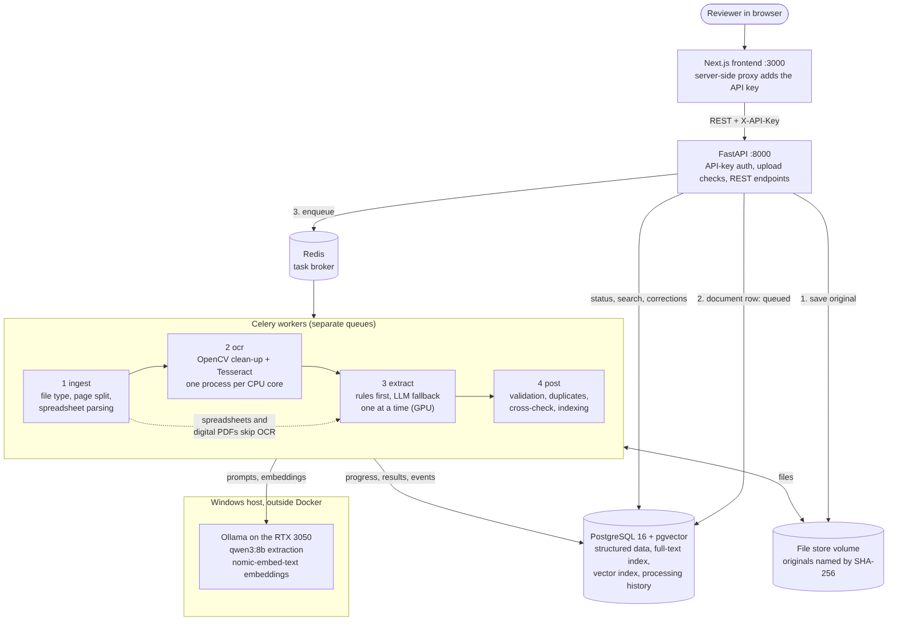
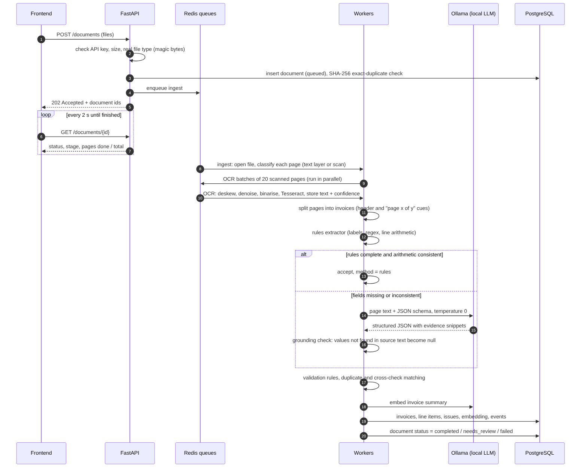

# Architecture

Source: [`diagrams/architecture.mmd`](diagrams/architecture.mmd). Processing
sequence: [`diagrams/pipeline.png`](diagrams/pipeline.png).

## 1. Overview

The system takes business documents in seven formats, turns each invoice in
them into validated structured data, and makes the results searchable and
correctable through a REST API and a web interface.

Everything runs on one machine with Docker Compose, and the language model
runs locally through Ollama. No document content leaves the machine.

| Component | Technology | Role |
|---|---|---|
| Frontend | Next.js (App Router, TypeScript), Tailwind, TanStack Query | Upload, progress, review and correction, search |
| API | FastAPI, Pydantic, SQLAlchemy 2, Alembic | Authentication, upload checks, REST endpoints |
| Task queue | Celery with Redis as broker | Background processing on four separate queues |
| Database | PostgreSQL 16 with pgvector and pg_trgm | Structured data, full-text search, vector search, history |
| File store | Docker volume, files named by SHA-256 | Original uploads |
| OCR | OpenCV pre-processing, Tesseract 5 | Scanned PDFs and images |
| Language model | Ollama, `qwen3:8b` | Field extraction where rules are not enough |
| Embeddings | Ollama, `nomic-embed-text` (768 dimensions) | Semantic search |

## 2. Processing pipeline

A document moves through four stages. Each stage is a Celery task on its own
queue, so each can be scaled to match the resource it uses.

| Stage | Queue | Bound by | What it does |
|---|---|---|---|
| 1. Ingest | `ingest` | Disk | Confirms the real file type from its first bytes, rejects corrupted, empty and encrypted files, counts pages, decides per page whether it has a text layer or is a scan, parses spreadsheets |
| 2. OCR | `ocr` | CPU | Only for scanned pages and images. Pages are processed in batches of 20 in parallel. Each page is cleaned up (greyscale, upscaling of low-resolution scans, deskewing, denoising, adaptive thresholding) and then read with Tesseract, which also returns a confidence score |
| 3. Extract | `extract` | GPU | Splits multi-invoice documents into invoices, then extracts the fields (see section 3) |
| 4. Post | `post` | Database | Validation rules, duplicate detection and cross-verification, embedding and indexing, final status |

Document status moves `queued → processing → completed | needs_review | failed`.
The current stage and a page counter (`progress_done` of `progress_total`) are
written to the database as work proceeds; the frontend polls every two
seconds.

**Splitting multi-invoice PDFs.** A page starts a new invoice when it carries
a new invoice number or a "page 1 of N" marker; "continued" markers and
"page k of N" (k above 1) attach a page to the current invoice. Every invoice
records its page range.

**Spreadsheets** never go through OCR. Ledger-style sheets (one row per line,
with an invoice number column) are grouped by invoice number. Form and
multi-sheet layouts are read by matching labels such as "Invoice No",
"Vendor" or "Gross Total" against a synonym list. Native numeric and date
cells are used as they are, so no number parsing is needed. Sheets that match
neither pattern are converted to text and sent to the language model.

## 3. Extraction: rules first, model second, nothing invented

Each invoice goes through two tiers.

**Tier 1, rules.** A deterministic extractor finds labelled fields
("Invoice No", "Amount Due", "Bill To" and their synonyms) and line-item rows
matching *description, quantity, unit price, amount* where quantity × price
equals the amount. If every required field is found and the arithmetic
agrees (line items add up to the subtotal, and subtotal plus tax equals the
total), the result is accepted. Arithmetic that agrees is strong evidence
that the numbers were read correctly.

**Tier 2, language model.** If any field is missing or the arithmetic does
not agree, the invoice text is sent to `qwen3:8b` through Ollama with:

- a JSON schema that constrains the output to the required fields
  (Ollama structured outputs);
- temperature 0, so the same input gives the same output;
- an instruction to return `null` for anything not printed, and to quote
  the snippet of text each value came from.

Long invoices are processed in parts: the header and totals from the first
and last pages, and line items page by page.

**Grounding check.** Every value from the model is checked against the
source text. If the quoted snippet, or the value itself after normalisation,
cannot be found in the text, the value is discarded, the field is set to
`null`, and an `ungrounded_value` warning is raised. This is the main defence
against invented values.

**Normalisation** turns printed text into typed values: Indian digit grouping
(1,23,456.00) and European decimals (1.234,56) into decimals; day-first or
month-first dates, decided by locale cues such as the currency; currency
symbols into ISO codes.

Every field gets a confidence score from its source (native spreadsheet
cell, rules with agreeing arithmetic, model with grounding, OCR confidence of
the page). Low-confidence fields send the invoice to manual review.

## 4. Validation and cross-verification

| Rule | Severity | Code |
|---|---|---|
| Required field missing (number, date, supplier, customer, total, currency) | error | `missing_field` |
| Subtotal plus tax differs from total by more than 0.01 | error | `total_mismatch` |
| Line items do not add up to the subtotal | error | `line_items_mismatch` |
| A line amount is not quantity times unit price | warning | `line_amount_mismatch` |
| A printed tax rate times the subtotal does not give the printed tax | warning | `tax_rate_mismatch` |
| Negative or implausibly large amount, or a date in the future | warning | `implausible_value` |
| Model value not found in the source text | warning | `ungrounded_value` |
| Field confidence below threshold | warning | `low_confidence` |
| The same invoice appears in another document | warning | `duplicate` |
| The other document disagrees on a field | error | `cross_mismatch` |

Any error, or any warning on a key field, sets the invoice to `needs_review`.

**Duplicates and cross-verification** use the same mechanism. Each invoice
gets a match key built from the normalised supplier name (lower case,
punctuation and legal suffixes such as Ltd, LLC and GmbH removed) and the
normalised invoice number. Invoices sharing a key form a group. Where the
invoice number is missing, the fallback is a similar supplier name
(trigram similarity) with the same date and total. Reviewers can also link
two invoices by hand.

Within a group, every field and every line item is compared. A group where
everything agrees is a `consistent` duplicate. A group that disagrees is a
`mismatch`, with the differing fields listed. This covers PDF-to-PDF and
PDF-to-spreadsheet verification without needing to know in advance which
document is the reference. An exact re-upload of the same file is caught
earlier, at upload, by its SHA-256 hash.

## 5. Search

- **Keyword filtering:** supplier, customer, invoice number, date range,
  amount range, currency, status and issue type, as indexed SQL filters;
  free text through a PostgreSQL full-text index over the extracted fields,
  line-item descriptions and document text.
- **Semantic search:** each invoice is summarised as text (supplier,
  customer, items, totals), embedded with `nomic-embed-text` and stored in a
  pgvector column with an HNSW index. A query such as "printer supplies from
  Dhaka vendors" finds matching invoices without exact words in common.
- **Hybrid:** results from both are combined with reciprocal rank fusion and
  can still be narrowed by the keyword filters.

## 6. Performance and scalability

- Digital PDF pages take milliseconds; only scanned pages pay the OCR cost,
  and they are processed in parallel batches across CPU cores.
- The GPU is the bottleneck, so the extract queue runs one task at a time and
  the rules tier keeps as many invoices as possible away from the model.
- Uploads are streamed to disk in chunks, never held in memory whole.
- The API is stateless, so more API containers and more workers per queue
  can be added without code changes. Moving the file store to S3-compatible
  storage would allow workers on several machines.
- The evaluation report measures time per page by format and the share of
  invoices handled by each tier, including a 1,000-page PDF run.

## 7. Reliability

- **Idempotent tasks.** Re-running a stage replaces its previous output
  instead of adding to it, so a retried task cannot create duplicate rows.
- **Retries.** Temporary failures (model timeout, database connection) are
  retried with exponential backoff. Permanent failures (corrupted file,
  encryption) are not retried; the document is marked `failed` with an error
  code and message.
- **No lost work.** Tasks are acknowledged only after they finish, so a
  worker crash returns the task to the queue.
- **Reprocessing.** Failed documents can be resubmitted individually or in
  bulk. Every attempt is recorded in `processing_runs`, with per-stage
  timings and a log in `processing_events`.
- **Health check.** `/health` reports database, Redis and Ollama status.

## 8. Security

- **API key** on every endpoint except `/health`, compared in constant time.
  The browser never sees it: the Next.js server proxies requests and adds
  the key.
- **Upload checks:** allowed formats only, verified by file signature, not by
  extension; size and file-count limits per request; stored filenames are
  hashes, so user-supplied names never touch the file system.
- **Parser hardening:** a pixel limit against decompression bombs; spreadsheets
  opened read-only with row limits; all parsing happens in workers, never in
  the API process.
- **Database access** only through the ORM with parameterised queries.
- **Rate limiting** on upload and search endpoints.
- **CORS** restricted to the frontend's origin.
- **Secrets** supplied through environment variables; none in the repository.
- **Containers** run as a non-root user.
- **Data privacy:** the language model and embeddings run locally, so
  invoice data is never sent to a third party.
- **Audit trail:** every manual correction is stored with old value, new
  value, user and time.

## 9. Design decisions against the suggested stack

| Suggested | Chosen | Reason |
|---|---|---|
| Node.js / NestJS | Python / FastAPI | OCR, pandas and model tooling are Python; one backend language instead of two |
| BullMQ | Celery with Redis | The Python equivalent; still uses Redis as suggested |
| A separate vector database | pgvector inside PostgreSQL | One database to run and back up; searches can combine vector similarity with SQL filters in one query |
| MongoDB | PostgreSQL | Invoices, line items, issues and corrections are relational; exact `numeric` type for money; JSONB still available for model output |
| An LLM API | Local model through Ollama | No cost, no rate limits for 1,000-page files, and no invoice data sent to a third party |

## 10. Known limitations

- An 8-billion-parameter local model is less accurate than large hosted
  models; the provider interface allows swapping in a hosted model by
  configuration if data policy permits.
- Tesseract struggles with very low-resolution or heavily distorted photos;
  the evaluation reports accuracy by image quality.
- Handwriting and non-English text are out of scope.
- One API key rather than per-user accounts; adding user accounts and roles
  is the next security step.
