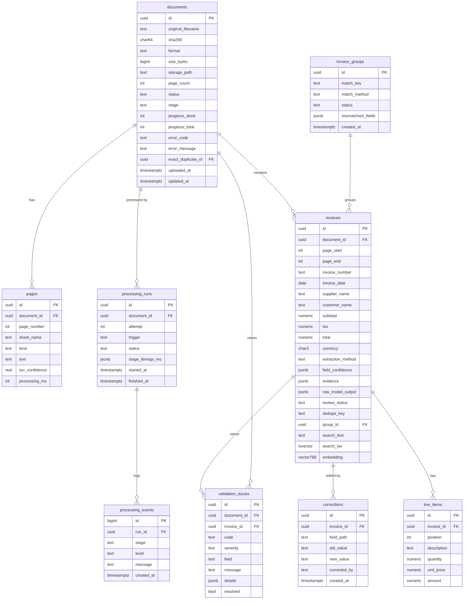

# Database schema

PostgreSQL 16 with the `vector` (pgvector) and `pg_trgm` extensions.
Migrations are managed with Alembic; the SQLAlchemy models in
`backend/app/models/` are the source of truth.



Source: [`diagrams/schema.mmd`](diagrams/schema.mmd).

## Conventions

- Primary keys are UUIDs, so ids can be created in the API before the row is
  written and cannot be guessed in URLs.
- Money is `numeric(14,2)`, quantities and unit prices `numeric(14,4)`.
  Never floating point.
- Every table has `created_at`; mutable tables also have `updated_at`.
- Status and code columns are `text` with `CHECK` constraints rather than
  PostgreSQL enums, which are awkward to change in migrations.
- Deleting a document deletes its pages, invoices, line items, issues and
  history (`ON DELETE CASCADE`).

## Tables

### `documents`
One row per uploaded file.

| Column | Type | Notes |
|---|---|---|
| `id` | uuid PK | |
| `original_filename` | text | As uploaded; shown to users, never used as a path |
| `sha256` | char(64) | Content hash; also the stored filename |
| `format` | text | `pdf`, `jpg`, `png`, `tiff`, `xlsx`, `xls`, `csv`, detected from content |
| `size_bytes` | bigint | |
| `storage_path` | text | Relative path in the file store |
| `page_count` | int | Pages for PDF and TIFF, sheets for workbooks |
| `status` | text | `queued`, `processing`, `completed`, `needs_review`, `failed` |
| `stage` | text | `ingest`, `ocr`, `extract`, `post`, `done` |
| `progress_done`, `progress_total` | int | Page counter for the progress bar |
| `error_code`, `error_message` | text | Set when `failed`: `corrupted`, `encrypted`, `empty_file`, `no_data`, `unsupported_format`, `timeout`, `internal` |
| `exact_duplicate_of` | uuid FK → documents | Same SHA-256 uploaded before |
| `uploaded_at`, `updated_at` | timestamptz | |

Indexes: `status`, `sha256`, `uploaded_at`.

### `pages`
One row per PDF or TIFF page, image, or spreadsheet sheet.

| Column | Type | Notes |
|---|---|---|
| `document_id` | uuid FK | |
| `page_number` | int | 1-based; unique with `document_id` |
| `sheet_name` | text | Spreadsheets only |
| `kind` | text | `digital`, `scanned`, `sheet` |
| `text` | text | Extracted or OCR text |
| `ocr_confidence` | real | Mean Tesseract word confidence, 0 to 100; null for digital pages |
| `processing_ms` | int | Time spent on this page |

### `invoices`
One row per invoice found. A document can hold several.

| Column | Type | Notes |
|---|---|---|
| `document_id` | uuid FK | |
| `page_start`, `page_end` | int | Where the invoice sits in the document |
| `invoice_number` … `currency` | | The nine required fields. All nullable: null means not on the document |
| `subtotal`, `tax`, `total` | numeric(14,2) | |
| `currency` | char(3) | ISO 4217 |
| `extraction_method` | text | `spreadsheet`, `rules`, `llm`, `manual` |
| `field_confidence` | jsonb | `{"total": 0.98, "invoice_date": 0.61, ...}` |
| `evidence` | jsonb | Source snippet for each field, shown in the review screen |
| `raw_model_output` | jsonb | Unmodified model response, kept for debugging and audit |
| `review_status` | text | `auto_approved`, `needs_review`, `reviewed` |
| `dedupe_key` | text | Normalised `supplier|invoice_number` |
| `group_id` | uuid FK → invoice_groups | Set when the same invoice appears elsewhere |
| `search_text` | text | Fields, line-item descriptions and page text, written by the worker |
| `search_tsv` | tsvector | Generated from `search_text`: `to_tsvector('simple', search_text)` |
| `embedding` | vector(768) | `nomic-embed-text` embedding of the invoice summary |

Indexes:
- `dedupe_key` (B-tree), for duplicate matching
- `invoice_date`, `total`, `currency`, `review_status` (B-tree), for filters
- `supplier_name` and `customer_name` (GIN, `gin_trgm_ops`), for partial and fuzzy name matching
- `search_tsv` (GIN), for full-text search
- `embedding` (HNSW, `vector_cosine_ops`), for semantic search

### `line_items`

| Column | Type | Notes |
|---|---|---|
| `invoice_id` | uuid FK | |
| `position` | int | Order on the invoice |
| `description` | text | |
| `quantity`, `unit_price` | numeric(14,4) | |
| `amount` | numeric(14,2) | |

### `validation_issues`
One row per problem found. Attached to an invoice, or to the document alone
for file-level problems.

| Column | Type | Notes |
|---|---|---|
| `document_id` | uuid FK | |
| `invoice_id` | uuid FK, nullable | |
| `code` | text | `missing_field`, `total_mismatch`, `line_items_mismatch`, `line_amount_mismatch`, `tax_rate_mismatch`, `implausible_value`, `ungrounded_value`, `low_confidence`, `duplicate`, `cross_mismatch` |
| `severity` | text | `error`, `warning`, `info` |
| `field` | text | Field concerned, for example `total` or `line_items[2].amount` |
| `message` | text | Human-readable |
| `details` | jsonb | For example `{"expected": "1150.00", "found": "1200.00"}` |
| `resolved` | bool | Set when a correction or review clears it |

Validation is re-run after every correction: unresolved issues for that
invoice are replaced, resolved ones are kept for the record.

### `invoice_groups`
The same invoice found in more than one document.

| Column | Type | Notes |
|---|---|---|
| `match_key` | text | The shared `dedupe_key`, or a description of the fallback match |
| `match_method` | text | `key`, `fuzzy`, `manual` |
| `status` | text | `consistent` (all fields agree) or `mismatch` |
| `mismatched_fields` | jsonb | For example `["total", "line_items"]` |

### `corrections`
Audit trail of manual edits.

| Column | Type | Notes |
|---|---|---|
| `invoice_id` | uuid FK | |
| `field_path` | text | `total`, `line_items[3].quantity` |
| `old_value`, `new_value` | text | As strings, so any type can be recorded |
| `corrected_by` | text | Reviewer name sent with the request |
| `created_at` | timestamptz | |

### `processing_runs` and `processing_events`
Processing history. Each upload or reprocess creates a run; each stage
writes events to it.

| `processing_runs` column | Notes |
|---|---|
| `document_id`, `attempt` | Attempt 1 is the upload; later attempts are reprocessing |
| `trigger` | `upload`, `reprocess`, `bulk_reprocess` |
| `status` | `running`, `succeeded`, `failed` |
| `stage_timings_ms` | `{"ingest": 40, "ocr": 3120, "extract": 2210, "post": 95}` |
| `started_at`, `finished_at` | |

| `processing_events` column | Notes |
|---|---|
| `run_id` | |
| `stage`, `level` | `level`: `info`, `warning`, `error` |
| `message` | For example "Page 3 OCR confidence 41, below threshold" |

## Typical queries

```sql
-- Review queue: invoices with unresolved errors, oldest first
SELECT i.* FROM invoices i
WHERE i.review_status = 'needs_review'
ORDER BY i.created_at;

-- Keyword search with filters
SELECT id, supplier_name, total, ts_rank(search_tsv, q) AS rank
FROM invoices, plainto_tsquery('simple', 'toner cartridge') q
WHERE search_tsv @@ q AND currency = 'BDT' AND invoice_date >= '2026-06-01'
ORDER BY rank DESC LIMIT 20;

-- Semantic search (query embedding supplied by the API)
SELECT id, supplier_name, 1 - (embedding <=> :query_vec) AS similarity
FROM invoices
ORDER BY embedding <=> :query_vec LIMIT 20;
```
